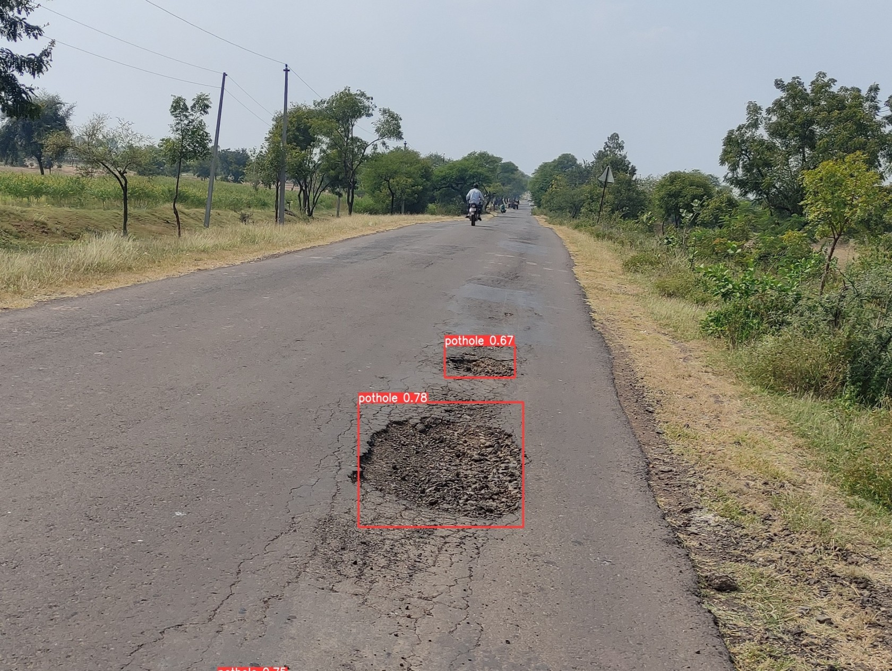
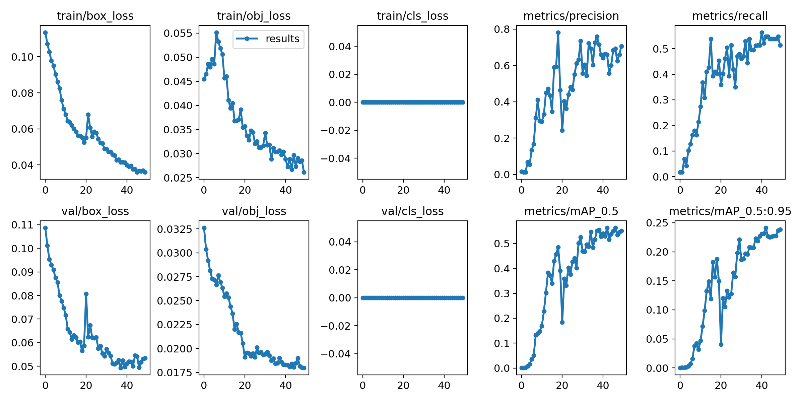

<div align="center">
<h1>RoadVision AI - Real-Time Pothole & Road Damage Detection</h1>

<p>
Autonomous real-time road hazard detection platform powered by <strong>Ultralytics YOLOv5</strong>, providing modular inference, hazard tracking, and live video streaming.
</p>

<p align="center">

</p> 
   
#### Click on YouTube icon below to see the real time video inference or Click <a href="https://youtu.be/b0Lm3yeNxPM">Here</a>.
<br>
   
<div align="center">
   <a href="https://youtube.com/playlist?list=PLM5rSizdAguQ9ehaJd1he7Tap8_EREmvc">
   
   </a>
   
   <a href="https://github.com/abhip07">
   
   </a>
   
   <a href="https://www.linkedin.com/in/abhishek-pawar-8537971b1/">
   
   </a>
</div>
<br>
</div>

---

## 🏗️ Refactored Project Structure

```text
realv/
├── app/                            # Modular application layer
│   ├── core/                       # Centralized configuration and logging
│   │   ├── config.py               # Path resolutions & environment variables
│   │   └── logging.py              # Standardized structured logger
│   ├── inference/                  # Clean computer vision inference interface
│   │   ├── detector.py             # InferenceEngine wrapping YOLOv5
│   │   └── postprocess.py          # Bounding boxes, corner accents, and HUD overlays
│   ├── camera/                     # Video capture & camera interfaces
│   │   ├── manager.py              # Threaded CameraManager (Video/Webcam/USB)
│   │   └── adb_helper.py           # Android USB ADB port forwarder
│   └── utils/                      # Shared utilities
│       ├── general.py              # Path validators & severity categorizer
│       └── tracking.py             # PotholeTracker (cross-frame deduplication)
│
├── scripts/                        # Maintenance & execution scripts
│   └── run_detection.py            # Modular CLI inference script
│
├── tests/                          # Automated test suite (pytest)
│   ├── test_config.py              # Configuration & env var tests
│   ├── test_paths.py               # File presence & path validation tests
│   └── test_inference.py           # Model inference & tracking tests
│
├── docs/                           # Architecture & user guides
│   ├── architecture.md             # System design & data flow
│   └── usage_guide.md              # Detailed execution documentation
│
├── weights/                        # Model checkpoints directory
│   └── pothole_best.pt             # Trained YOLOv5 Pothole model weights
│
├── yolov5/                         # Original YOLOv5 configurations & assets
│   ├── data/                       # Dataset configs and sample images
│   ├── hyperparameters/            # Hyperparameter configs (hyp.yaml, opt.yaml)
│   └── models/                     # Model architecture YAMLs (yolov5l.yaml)
│
├── detect.py                       # Original YOLOv5 detection entry point (preserved)
├── train.py                        # Original YOLOv5 training script (preserved)
├── val.py                          # Original YOLOv5 validation script (preserved)
├── export.py                       # Original YOLOv5 export script (preserved)
├── run.py                          # Web dashboard launcher
├── requirements.txt                # Unified Python dependencies
├── .env.example                    # Template environment variables
└── .gitignore                      # Git exclusion rules
```

---

## ⚡ Quickstart Guide

### 1. Installation
Activate the Python virtual environment and install dependencies:

```bash
cd /Users/souravkumar/Desktop/realv
source .venv/bin/activate
pip install -r requirements.txt
```

### 2. Run Automated Tests
```bash
pytest tests/ -v
```

### 3. Run Detection on an Image

#### Option A: Using the New Modular Application CLI (Recommended)
```bash
python scripts/run_detection.py --source yolov5/data/images/img.jpg
```

#### Option B: Using the Original YOLOv5 CLI (Preserved)
```bash
python detect.py --weights weights/pothole_best.pt --source yolov5/data/images/img.jpg
```

### 4. Run Detection on Video Footage
```bash
python scripts/run_detection.py --source data/videos/road_test.mp4
```

### 5. Launch the Web Dashboard & Live Streaming Server
```bash
python run.py
```
Open **`http://localhost:8000`** in your browser (zero login required).

---

## 📊 Dataset & Original Training Results

In this Project I have used custom labelled dataset with some images from google to make the learning process more complex.

### Training Dataset Sample
<table border="0">
<tr>
    <td></td>
    <td></td>
</tr>
</table>

### Training Results
<p align="left"></p>

---

## 🤝 Attribution & Credits
Original model training and dataset by **Abhishek Pawar** ([GitHub](https://github.com/abhip07) / [LinkedIn](https://www.linkedin.com/in/abhishek-pawar-8537971b1/)).
Refactored and modernized as **RoadVision AI**.
