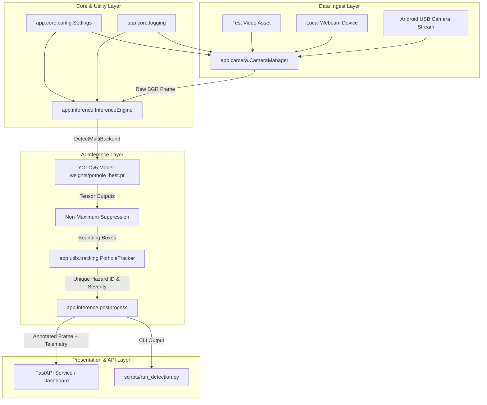

# RoadVision AI - System Architecture & Technical Design

## 1. Overview
RoadVision AI is a modular, high-performance edge road damage detection platform. It decouples the core computer vision inference layer (built on Ultralytics YOLOv5) from high-level application logic (camera capture, tracking, centralized configuration, and web streaming).

---

## 2. Layered Architecture

---

## 3. Module Responsibilities

### `app/core/`
- **`config.py`**: Centralized, type-safe settings (`Settings` singleton) managing model paths, confidence thresholds, image sizes, and environment variable overrides (`CONF_THRESHOLD`, `DEVICE`, etc.).
- **`logging.py`**: Standardized logging with timestamps and log levels.

### `app/inference/`
- **`detector.py`**: `InferenceEngine` encapsulates model loading, letterboxing, warmup, batch formatting, and hardware execution (CPU/MPS/CUDA).
- **`postprocess.py`**: Handles bounding box rendering, corner accent markers, tag pills, and HUD telemetry overlays.

### `app/camera/`
- **`manager.py`**: `CameraManager` manages non-blocking threaded frame capture across video files, local webcams, and network/USB RTSP/HTTP streams.
- **`adb_helper.py`**: Manages USB port tunneling (`adb forward tcp:8080 tcp:8080`) to stream video over physical USB cable.

### `app/utils/`
- **`tracking.py`**: `PotholeTracker` tracks centroid trajectories across frames to ensure unique potholes are only counted once.
- **`general.py`**: Path validation, image integrity checks, and hazard severity classification (Critical, Moderate, Minor).

### `yolov5/`, `models/`, `utils/`
- Original, preserved YOLOv5 v6.1 implementation supporting legacy scripts (`train.py`, `val.py`, `detect.py`, `export.py`).
